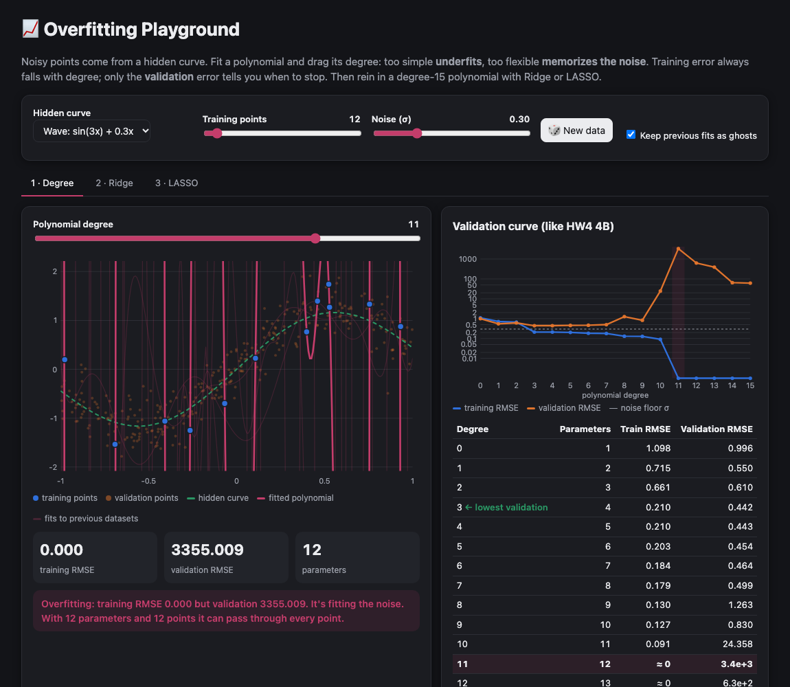
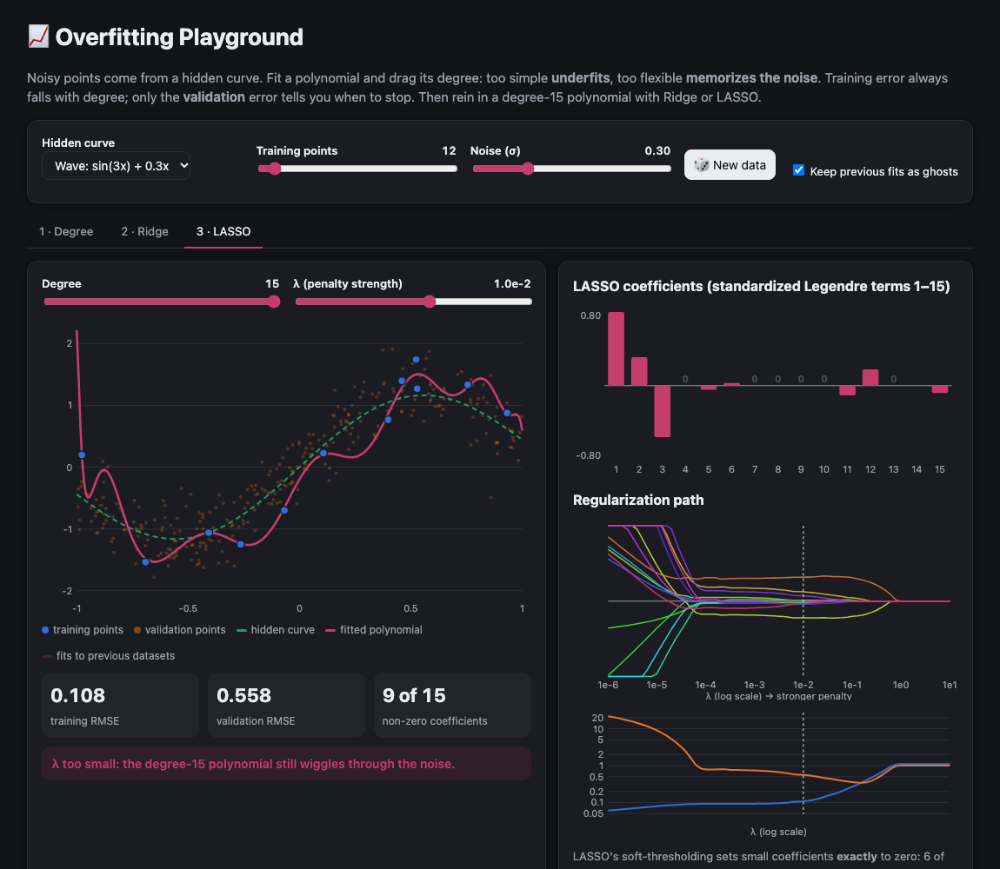

# Overfitting Playground 📈

An interactive page for HW4 4B. Noisy points come from a hidden curve, and you fit polynomials of degree 0–15. A degree slider shows the fitted curve, **training and validation RMSE live**, and the full validation curve and table like the HW4 4B table. Ridge and LASSO tabs add a λ slider showing the coefficients shrink; LASSO's coefficients hit **exactly zero**.

| Degree 11 on 12 points (with ghosts of earlier datasets) | LASSO at λ = 0.01 |
|---|---|
|  |  |

## Features

- **Hidden curves:** wave, gentle quadratic or bump. Sliders control the training points (8–80) and the noise σ. Validation uses 300 fresh points.
- **Degree tab:**
  - **verdict:** underfitting, about right, or overfitting
  - **validation curve:** a log-scale chart with the noise floor σ marked
  - **table:** marks the lowest validation error, and shows "≈ 0" training error once the polynomial can pass through every point
- **🎲 New data:** redraws the training set and keeps the previous fits as faint **ghosts**. A degree-3 fit barely moves between datasets; a degree-12 fit swings wildly.
- **Ridge / LASSO tabs:**
  - a degree slider (2–15) and a log λ slider (10⁻⁶ to 10)
  - a coefficient bar chart, where LASSO zeros show as "0"
  - the full **regularization path**
  - a training/validation RMSE curve over λ, and the best λ

## Math

- **Basis:** Legendre polynomials on [−1, 1]. They span the same curves as 1, x, x², … but are well conditioned up to degree 15.
- **OLS:** least squares by Householder QR. When there are fewer points than parameters, a vanishing ridge gives the minimum-norm interpolant.
- **Ridge:** (1/n)Σ(y − ŷ)² + λΣβⱼ² on standardized features, solved exactly as an augmented least-squares problem.
- **LASSO:** (1/2n)Σ(y − ŷ)² + λΣ|βⱼ| by cyclic coordinate descent with soft-thresholding, so coefficients can be exactly 0.
- **Intercept:** never penalized.

## Tests

```
node test.mjs
```

There are 14 checks:
- **Legendre basis:** values and orthogonality are correct.
- **Exact fitting:**
  - a noiseless cubic is recovered exactly
  - QR satisfies the normal equations
  - **degree 9 through 10 points gives training RMSE ≈ 0**, as in HW4 4B
- **Bias–variance over 200 datasets:** average training RMSE never rises with degree, and validation error is U-shaped (best at degree 3 for the wave).
- **Ridge:** zero gradient at the closed-form solution, a coefficient norm that shrinks monotonically with λ, and no exact zeros.
- **LASSO:** satisfies the KKT conditions, the number of exact zeros grows with λ, and a huge λ gives the mean.
- **Variance across datasets:** degree-12 predictions near the edge vary more than 1,000× as much as degree 3.
